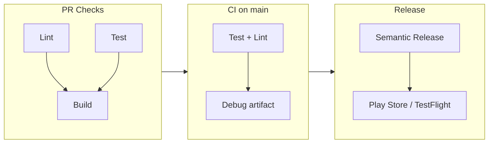

# Mobile CI/CD Templates

[](https://github.com/hendra-marihot/mobile-ci-cd-templates/actions/workflows/ci.yml)
[](LICENSE)

Copy-paste CI/CD templates for Android and Flutter: PR gates, CI on main, release automation and code signing. Each template stands alone. Copy the files you need, fill in the placeholders, and you have a pipeline.



## Why

CI/CD is part of a senior mobile engineer's job, but it usually lives in private repos and gets rebuilt from memory on every project. This repo makes the patterns I reach for visible and reviewable.

## What's here

Seven GitHub Actions workflows, two Fastlane setups, a Codemagic config for Flutter and five shell scripts.

| Layer | Android | Flutter | Shared |
|---|---|---|---|
| **PR gates** | Parallel lint + test, gated build | Parallel format + analyze, gated test + build | |
| **CI** | Test, lint, debug APK | Format, analyze, test with coverage gate | |
| **CD** | Signed AAB to Play Store internal | Signed AAB + unsigned iOS artifact | Semantic release from Conventional Commits |
| **Fastlane** | test, build, deploy, promote | Firebase, Play Store, TestFlight | |
| **Scripts** | Signing setup, version bump | Coverage check, build_runner | Changelog generator |
| **Codemagic** | | Release build + PR test workflow | |

iOS is covered by Flutter's cross-platform build and a [Matchfile](ios/fastlane/Matchfile) for `match` signing. There are no iOS-only workflows. See [Out of scope](#out-of-scope).

## Key decisions

### Parallel jobs, not one long job

PR workflows split lint, test and build into separate jobs. Lint and test run in parallel. Build starts only after both pass.

```yaml
# android/github-actions/pr-checks.yml
jobs:
  lint:
    runs-on: ubuntu-latest
    # ...
  unit-test:
    runs-on: ubuntu-latest
    # ...
  build:
    needs: [lint, unit-test]  # only runs if both pass
```

One sequential job is simpler and saves a few seconds of runner startup. Parallel jobs give faster feedback when one thing is broken, and separate logs are easier to read. On a team, feedback time wins.

### Releases never cancel in progress

CI workflows set `cancel-in-progress: true` so a new push kills the stale run. Release workflows set it to `false`. A cancelled release can leave a half-uploaded artifact or a tag without a GitHub Release. A redundant release costs minutes. A broken one costs manual cleanup.

### A guard before semantic versioning

The [semantic release workflow](shared/github-actions/semantic-release.yml) checks for `feat:` or `fix:` commits before it tags. Without the guard, every `docs:` or `chore:` merge bumps the patch version and creates noise tags.

### Portable shell

Scripts use `grep -oE` not `grep -oP`, temp-file `sed` not `sed -i`, and `base64 --decode`. They run the same on GNU (Linux runners) and BSD (macOS). The [BATS tests](tests/script-quality.bats) fail if someone adds a GNU-only flag.

### Env var overrides

Scripts accept overrides for paths they would otherwise hardcode:

```bash
# android/scripts/version-bump.sh
GRADLE_FILE=${GRADLE_FILE:-app/build.gradle.kts}
```

Tests point the scripts at temp fixtures. That is the difference between scripts you test by hand and scripts with automated coverage.

## How the templates test themselves

There is no application here, so a [meta-CI pipeline](.github/workflows/ci.yml) validates the templates on every PR:

1. **shellcheck** on every `.sh` file
2. **yamllint** on every workflow
3. **51 BATS tests** in 7 suites, covering:
   - Behavior: version bumps, coverage extraction from lcov, changelog grouping by commit type
   - Structure: `set -euo pipefail` in every script, no hardcoded secrets, executable bits set
   - Portability: no GNU-only flags, Matchfile in the right place
   - Workflow conventions: concurrency groups, declared permissions, pinned action versions, the semantic release guard

Most teams treat CI templates as write-once config. A wrong grep flag or a missing `if: always()` on an artifact upload fails silently in production. These tests exist because I have hit those bugs.

## Out of scope

- **Multi-module Android.** The templates assume one `app/` module. Multi-module Gradle setup does not generalize.
- **Monorepos.** Path filters and selective builds are a different problem.
- **Full iOS CI/CD.** Signing, provisioning and App Store Connect depend on each Apple account. A "complete" iOS workflow would look ready and still need heavy customization. The Matchfile shows the signing pattern.
- **KMP.** Covered in [kmp-currency-converter](https://github.com/hendra-marihot/kmp-currency-converter).
- **Staging and production matrices.** The templates target one release track.

## What I would improve

- **End-to-end workflow tests.** BATS checks scripts and YAML structure but cannot run a workflow. [act](https://github.com/nektos/act) could help, with its limits around secrets and runners.
- **Codemagic for iOS.** The Codemagic config covers Flutter Android only.

## Related repositories

Each repo in this set covers one area of mobile engineering.

| Repository | Focus |
|---|---|
| [compose-newsreader](https://github.com/hendra-marihot/compose-newsreader) | Multi-module Android, Hilt, Room, offline-first |
| [android-design-system](https://github.com/hendra-marihot/android-design-system) | Compose component library, design tokens |
| [compose-performance-lab](https://github.com/hendra-marihot/compose-performance-lab) | Compose performance anti-patterns and fixes |
| [kmp-currency-converter](https://github.com/hendra-marihot/kmp-currency-converter) | Kotlin Multiplatform, shared business logic |
| [flutter-expense-tracker](https://github.com/hendra-marihot/flutter-expense-tracker) | Clean Architecture, Riverpod, Drift, Material 3 |
| [flutter-ui-toolkit](https://github.com/hendra-marihot/flutter-ui-toolkit) | Reusable widgets, shimmer, adaptive layouts |
| [flutter-platform-bridge](https://github.com/hendra-marihot/flutter-platform-bridge) | Platform channels, native interop |
| **mobile-ci-cd-templates** (this repo) | CI/CD, release automation |

## License

Copyright 2026 Hendra Marihot. Licensed under the [Apache License 2.0](LICENSE).
