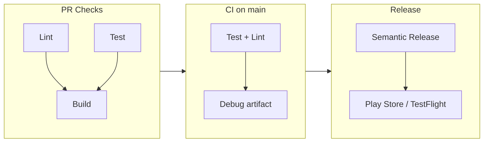

# Mobile CI/CD Templates

[](https://github.com/hendra-marihot/mobile-ci-cd-templates/actions/workflows/ci.yml)
[](LICENSE)

CI/CD workflow templates for Android and Flutter — covering PR gates, continuous integration, release automation, and code signing. Part of a [broader portfolio](#related-repositories) demonstrating senior mobile engineering competencies.



## Why this exists

CI/CD is one of the things every senior mobile engineer is expected to own, but it's also one of the hardest to demonstrate — it usually lives inside private repos and gets built once per project from memory. I wanted to make that knowledge visible and reviewable.

This repository is a reference collection of the CI/CD patterns I reach for on new Android and Flutter projects. Each template is self-contained: copy the files you need into a project, fill in the placeholder values, and you have a working pipeline. Nothing depends on anything else in this repo.

## What's here

Seven GitHub Actions workflows, two Fastlane configurations, a Codemagic setup for Flutter, and five shell scripts — organized by platform.

| Layer | Android | Flutter | Shared |
|---|---|---|---|
| **PR gates** | Parallel lint + test, gated build | Parallel format + analyze, gated test + build | — |
| **CI** | Test, lint, debug APK | Format, analyze, test with coverage gate | — |
| **CD** | Signed AAB → Play Store internal | Signed AAB + unsigned iOS artifact | Semantic release from Conventional Commits |
| **Fastlane** | test, build, deploy, promote | Firebase, Play Store, TestFlight | — |
| **Scripts** | Signing setup, version bump | Coverage check, build_runner | Changelog generator |
| **Codemagic** | — | Release build + PR test workflow | — |

iOS is covered through Flutter's cross-platform build and a [Matchfile](ios/fastlane/Matchfile) for `match`-based code signing, but there are no iOS-only workflows — more on why in [Non-goals](#non-goals).

## Key decisions

These are the tradeoffs I thought about most. They're the kind of decisions that don't show up in feature lists but determine whether a pipeline actually works in practice.

### Separate parallel jobs over a single monolithic workflow

The PR check workflows split lint, test, and build into independent jobs. Lint and test run in parallel; build only starts after both pass.

```yaml
# android/github-actions/pr-checks.yml
jobs:
  lint:
    runs-on: ubuntu-latest
    # ...
  unit-test:
    runs-on: ubuntu-latest
    # ...
  build:
    needs: [lint, unit-test]  # only runs if both pass
```

The alternative — one job running all three sequentially — would be simpler YAML and slightly cheaper (no job startup overhead). But parallel jobs give faster feedback on the most common case (only one thing is broken), and separate job logs make failures easier to read. On a team, that time-to-feedback difference matters more than a few seconds of runner startup.

### Release workflows don't cancel in progress

CI workflows use `cancel-in-progress: true` so pushing a fix kills the stale run. Release workflows explicitly set `cancel-in-progress: false`. A cancelled release can leave a half-uploaded artifact on the Play Store or a tag without a matching GitHub Release. The cost of a redundant release run is a few minutes of compute; the cost of a botched release is manual cleanup and possibly a broken rollout.

### A release guard for semantic versioning

The [semantic release workflow](shared/github-actions/semantic-release.yml) checks for `feat:` or `fix:` commits before creating a tag. Without this guard, every `docs:` or `chore:` merge to main would bump the patch version, generating noise tags that don't correspond to actual changes. This is a small detail, but it's the kind of thing that determines whether automated versioning is useful or just annoying.

### Portability-first shell scripts

Every script uses `grep -oE` instead of `grep -oP`, temp-file `sed` instead of `sed -i`, and `base64 --decode` — all for cross-platform compatibility between GNU (Linux CI runners) and BSD (macOS local dev, macOS CI runners). This adds some verbosity, but it means the scripts work everywhere without platform-specific branches. The [BATS tests](tests/script-quality.bats) enforce this — if someone introduces a GNU-only flag, CI catches it.

### Env var overrides for testability

Scripts accept env var overrides for paths they'd normally hardcode:

```bash
# android/scripts/version-bump.sh
GRADLE_FILE=${GRADLE_FILE:-app/build.gradle.kts}
```

This lets the BATS tests inject temp fixtures without touching real project files. It's a small pattern, but it's the difference between shell scripts that can only be tested manually and shell scripts with actual automated test coverage.

## How the templates validate themselves

This is a templates repo with no application code, so there's no build system to run. Instead, a [meta-CI pipeline](.github/workflows/ci.yml) validates the templates themselves on every PR:

1. **shellcheck** — static analysis on all `.sh` files
2. **yamllint** — syntax and style validation on all workflow YAML
3. **40 BATS tests** across 6 suites, covering:
   - Functional behavior (version bumps produce correct output, coverage extraction parses lcov, changelog groups commits by type)
   - Structural quality (every script has `set -euo pipefail`, no hardcoded secrets, all scripts are executable)
   - Portability (no GNU-only flags, Matchfile is in the right directory)
   - Workflow conventions (concurrency groups present, permissions declared, action versions pinned, semantic release guard exists)

Testing CI templates is uncommon — most teams treat them as write-once configuration. But these templates are the kind of code where a subtle bug (wrong grep flag, missing `if: always()` on artifact upload) silently breaks things in production. The tests exist because I've been bitten by those bugs.

## Non-goals

Things I intentionally left out, and why:

- **Multi-module Android builds.** The templates assume a single `app/` module. Multi-module requires project-specific Gradle configuration that doesn't generalize into a template.
- **Monorepo support.** Path-based workflow triggers and selective builds are a different problem space.
- **Full iOS CI/CD.** Code signing, provisioning profiles, and App Store Connect integration depend heavily on per-project Apple Developer account specifics. Including a "complete" iOS workflow would mean shipping something that looks ready but requires substantial customization to actually work. The Matchfile shows the signing pattern; the rest has to be per-project.
- **KMP/KMM.** Kotlin Multiplatform builds are covered in a separate portfolio project (kmp-currency-converter).
- **Environment-specific configs** (staging, production). These templates target the common case — a single release track. Environment matrices are a deployment concern, not a CI template concern.

## What I'd improve

- **Integration-level testing.** The BATS tests validate individual scripts and check workflow YAML structure, but they can't actually run a GitHub Actions workflow end-to-end. Tools like [act](https://github.com/nektos/act) could add local workflow execution testing, though they have their own limitations with secrets and runner environments.
- **Codemagic parity.** The Codemagic config only covers Flutter Android. Adding an iOS build workflow would make it a more complete alternative to the GitHub Actions setup.

## Related repositories

This is one piece of a portfolio covering different aspects of senior mobile engineering:

| Repository | Focus area |
|---|---|
| [compose-newsreader](https://github.com/hendra-marihot/compose-newsreader) | Multi-module Android, Hilt, Room, offline-first |
| [android-design-system](https://github.com/hendra-marihot/android-design-system) | Compose component library, design tokens |
| [compose-performance-lab](https://github.com/hendra-marihot/compose-performance-lab) | Compose performance anti-patterns and fixes |
| [kmp-currency-converter](https://github.com/hendra-marihot/kmp-currency-converter) | Kotlin Multiplatform, shared business logic |
| [flutter-expense-tracker](https://github.com/hendra-marihot/flutter-expense-tracker) | Clean Architecture, Riverpod, Drift, Material 3 |
| [flutter-ui-toolkit](https://github.com/hendra-marihot/flutter-ui-toolkit) | Reusable widgets, shimmer, adaptive layouts |
| [flutter-platform-bridge](https://github.com/hendra-marihot/flutter-platform-bridge) | Platform channels, native interop |
| **mobile-ci-cd-templates** (this repo) | CI/CD, release automation, infrastructure |

## License

Apache 2.0 — see [LICENSE](LICENSE).
